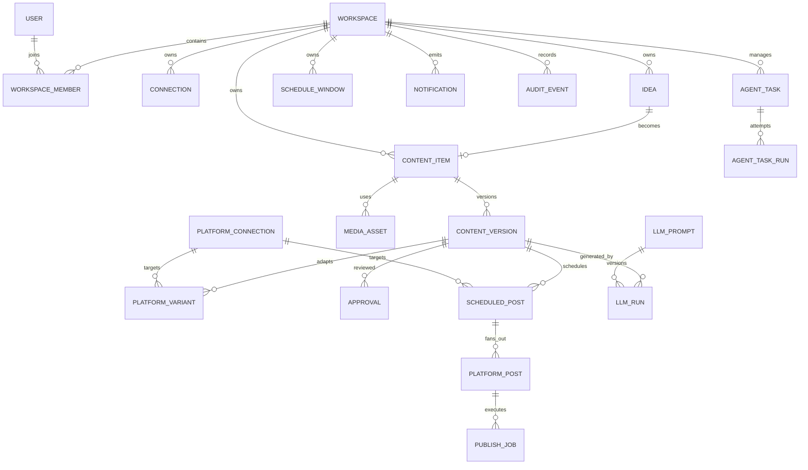

# Target Database Design

## Status

Proposed schema for the open platform. The current schema remains the starting point; this design adds multi-tenancy, planning, approvals, provider configuration, and auditability.

## Design principles

1. Every user-owned record belongs to a workspace.
2. Planning data is separate from execution data.
3. A content item is the canonical message; a platform post is a target-specific execution record.
4. Every external side effect has a durable job and idempotency key.
5. Generated content is versioned and never overwrites the last approved version.
6. Secrets are references or encrypted values, never ordinary configuration returned by the API.
7. Scheduling is explicit, timezone-aware, and auditable.

## Entity relationship view



## Core tables

### Identity and tenancy

- `workspaces`: workspace name, slug, status, default timezone, created_at, updated_at.
- `users`: identity-provider subject, display name, email, status.
- `workspace_members`: workspace_id, user_id, role, status, invited_by.
- `api_keys`: workspace_id, hashed key, scopes, last_used_at, expires_at.

Roles should start with `owner`, `editor`, `approver`, `viewer`, and `agent`. Agent access must be explicitly granted and limited to development or operations scopes.

### Connections and providers

- `provider_instances`: workspace_id, provider_type, provider_name, config_json, secret_ref, status, version.
- `social_connections`: provider_instance_id, platform, external_account_id, account_name, token_ref, status, scopes, last_verified_at.
- `llm_prompts`: purpose, version, system_template, input_schema, output_schema, evaluation_status.
- `notification_channels`: provider_type, target_ref, secret_ref, event_types, enabled.

`config_json` must be schema-validated and must not contain plaintext secrets.

### Planning and content

- `ideas`: workspace_id, title, body, source_type, source_ref, source_url, status, assigned_to, created_by.
- `content_pillars`: workspace_id, name, description, audience, default_hashtags, active.
- `content_items`: workspace_id, idea_id, title, objective, audience, pillar_id, status, created_by, owner_id.
- `content_versions`: content_item_id, version_number, body, brand_voice, source_notes, created_by, change_summary, is_locked.
- `media_assets`: workspace_id, storage_key, media_type, duration_seconds, width, height, codec, size_bytes, checksum, retention_until, created_by.
- `content_media`: content_item_id, media_asset_id, role, sort_order.
- `platform_variants`: content_version_id, connection_id, caption, title, hashtags, privacy, extra_json, created_by.

Use a unique constraint on `(content_item_id, version_number)` and a unique constraint on `(content_version_id, connection_id)`.

### Approval and scheduling

- `approvals`: content_version_id, target_type, target_id, decision, reviewer_id, comment, decided_at, expires_at.
- `schedule_windows`: workspace_id, name, timezone, days_of_week, start_time, end_time, capacity, enabled.
- `scheduled_posts`: workspace_id, content_version_id, connection_id, scheduled_at, timezone, policy, status, approved_version, idempotency_key.
- `quiet_hours`: workspace_id, connection_id, timezone, start_time, end_time, days_of_week, enabled.

Approval should be tied to a version and target. Editing the version must not silently inherit approval.

## Execution tables

Retain and evolve the current `assets`, `renditions`, and `publish_jobs` concepts.

- `publish_jobs`: workspace_id, scheduled_post_id, platform_post_id, state, attempt, max_attempts, queue, idempotency_key, claimed_at, lease_until, last_error, external_id.
- `platform_posts`: workspace_id, scheduled_post_id, connection_id, state, external_post_id, external_url, privacy, attempt, published_at, failed_at.
- `job_events`: job_id, event_type, attempt, code, user_message, internal_detail, created_at.
- `outbox_events`: aggregate_type, aggregate_id, event_type, payload, available_at, published_at, attempts.
- `dead_letters`: job_id, reason, payload, created_at, resolved_at, resolution.

`platform_posts` separates the user-visible target state from the internal job attempts. This makes it possible to retry one platform without changing sibling targets.

### Rendition state

`renditions` should eventually include:

- `workspace_id`
- `media_asset_id`
- `platform`
- `spec_version`
- `storage_key`
- `checksum`
- `state`
- `started_at`
- `completed_at`
- `error_code`

Use a unique key on `(workspace_id, media_asset_id, platform, spec_version)` and an atomic claim or row lock before starting work.

## Agent and audit tables

These tables support development coordination and must not be part of the content publish transaction.

- `agent_tasks`: workspace_id, key, title, goal, scope, non_goals, status, priority, assignee_agent, depends_on, acceptance_criteria, test_commands.
- `agent_task_runs`: task_id, agent_name, branch, status, started_at, completed_at, evidence_json, reviewer_note.
- `agent_decisions`: task_id, decision_type, summary, alternatives, created_by, created_at.
- `audit_events`: workspace_id, actor_type, actor_id, action, resource_type, resource_id, metadata, created_at.

The file-based agent workflow can operate first; these tables are a later optional integration.

## State transitions

### Content item

```text
IDEA -> DRAFT -> IN_REVIEW -> APPROVED -> SCHEDULED -> PUBLISHING -> PUBLISHED
                    \-> CHANGES_REQUESTED
                                      \-> REJECTED
```

### Scheduled post

```text
PENDING -> RELEASED -> CANCELLED
             \-> SKIPPED
```

### Platform post and job

```text
PENDING -> QUEUED -> RUNNING -> PROCESSING -> PUBLISHED
             \-> RETRY_WAIT -> QUEUED
             \-> FAILED
```

## Indexing and constraints

- Every tenant-owned table has an index beginning with `workspace_id`.
- Foreign keys use cascading deletion only for safe child records; audit and job history should be retained or anonymized.
- Add uniqueness for workspace slugs, content version numbers, connection external IDs, idempotency keys, and task keys.
- Use partial indexes for due schedules, pending outbox events, stale jobs, and approval inboxes.
- Store timestamps in UTC; keep the business timezone explicitly on schedule and workspace records.
- Validate JSON fields with database checks or application-level schema validation.

## Migration strategy

1. Add migrations and remove `create_all()` from production startup.
2. Add a default workspace and backfill existing rows.
3. Add nullable planning tables and populate them from existing `PublishJob` records.
4. Add `scheduled_posts` and `platform_posts` around the current job lifecycle.
5. Add an outbox and reconciliation worker.
6. Make workspace scoping mandatory for new routes and queries.
7. Add encrypted connection secret storage before external multi-user deployments.
