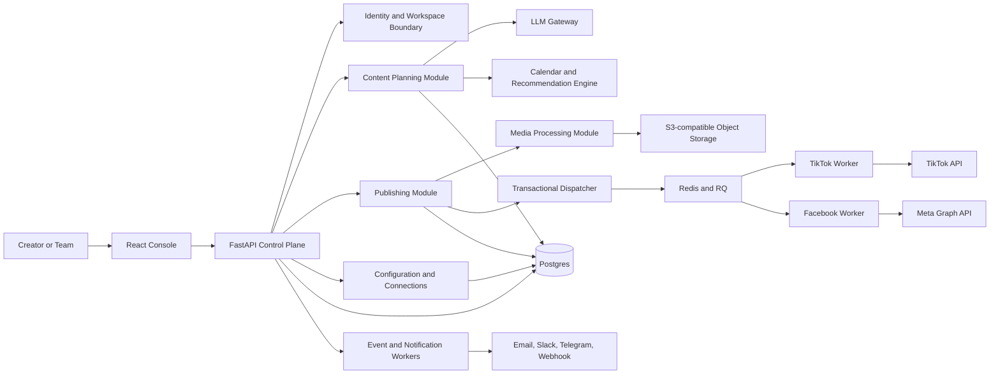
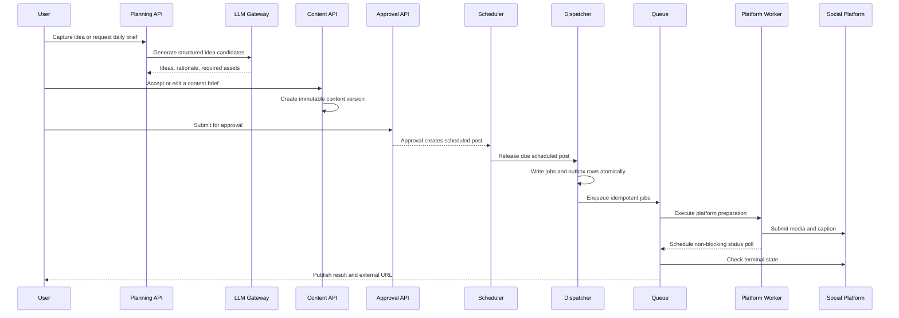

# Target Architecture

## Status

Proposed target architecture for evolving the current publishing pipeline into an open, multi-workspace content operations platform.

## Architecture decision

Start as a modular monolith with durable jobs and provider adapters. Do not split services into microservices merely to make the product sound distributed. Extract a service only when deployment, isolation, or scaling evidence requires it.

The current platform fan-out remains the execution boundary. Ideas, content planning, approvals, and LLM calls are upstream of publishing and must never be required for a manually created post to publish.

## System view

## Bounded modules

### Identity and workspaces

Owns users, workspaces, memberships, roles, invitations, API keys, and tenant-scoped authorization. Every user-owned table carries `workspace_id`.

### Planning

Owns ideas, briefs, content pillars, content calendars, templates, recommendations, and generated provenance. Planning can be unavailable without breaking manual publishing.

### Content studio

Owns content items, versions, media references, platform variants, approvals, and comments. A content item is the canonical message; a platform post is an execution record.

### Publishing

Owns schedule windows, scheduled posts, platform posts, jobs, retries, external platform IDs, and state transitions. It should call only deterministic preparation functions on the publish path.

### Media

Owns direct upload authorization, media validation, transcoding, rendition generation, retention, and deletion. Media preparation must be idempotent by content and platform specification.

### Provider registry

Resolves platform, storage, LLM, and notification implementations. Providers receive a narrow configuration object and do not read arbitrary environment variables.

### Agent operations

Provides task, decision, artifact, and review records for engineering automation. This is an internal development module, not a publishing dependency.

## Data flow

## Configuration hierarchy

Configuration should be resolved from narrow to broad scope. More specific configuration wins, but deployment secrets remain deployment concerns.

1. Platform deployment environment variables for infrastructure endpoints and secret references.
2. Workspace settings for storage, locale, default schedule, and feature flags.
3. Connection records for encrypted OAuth credentials and provider settings.
4. User preferences for timezone, quiet hours, notification preferences, and LLM usage.
5. Content-level settings for the audience, pillars, privacy, and explicit schedule.

A configuration record should include its source and version. For example, a schedule can state whether it came from a workspace default or a user override.

## LLM integration

Introduce a provider-neutral gateway with three layers:

### Prompt registry

Prompts are versioned records or controlled files. A prompt has a purpose, input schema, output schema, allowed model settings, and evaluation examples.

### Structured generation

Every generation request asks for JSON conforming to a versioned schema. Invalid output is a failed run, not a string to publish directly.

### Run ledger

An LLM run records provider, model, prompt version, input references, token usage, latency, status, safety result, and output reference. Do not store secrets in the run record.

Use LLM calls for:

- Idea expansion
- Content brief creation
- Caption variants
- Hashtag suggestions
- Remix suggestions
- Schedule recommendations
- Summaries of performance data

Do not use LLM calls to:

- Decide that a post is safe to publish without approval
- Directly execute a platform API request
- Retry a failed upload
- Block a deterministic publish task
- Hide provider errors in free-form text

## Plugin boundaries

A first-party platform adapter should implement capability declarations such as:

- Media upload by pull URL or chunk
- Caption and title length limits
- Scheduling support
- Public or private publishing
- Status polling
- Metrics import
- Account and token lifecycle

A plugin must declare supported capabilities, configuration requirements, and compatibility version. Core publishing should reject unsupported combinations explicitly.

## Reliability and security

- Use a transactional outbox between database writes and queue delivery.
- Use atomic job claims and idempotency keys.
- Keep platform jobs independent.
- Add dead-letter and stale-job recovery.
- Encrypt connection secrets at rest.
- Require authentication for every control-plane route.
- Scope every query and storage object to a workspace.
- Enforce media size, duration, codec, and retention limits before dispatch.
- Separate optional LLM and analytics traffic from the publish path.
- Record every approval, schedule change, retry, and credential operation in an append-only audit log.

## Migration from the current repository

1. Keep the existing `Asset`, `Rendition`, and `PublishJob` behavior working.
2. Add `workspace_id` through a staged migration and backfill a default workspace.
3. Introduce content items and platform posts as the planning-to-publish boundary.
4. Add the outbox and idempotent dispatch before enabling automatic scheduling.
5. Move the LLM providers behind the registry and prompt ledger.
6. Add approvals before enabling auto-publish policies.
7. Split services only after metrics justify it.
